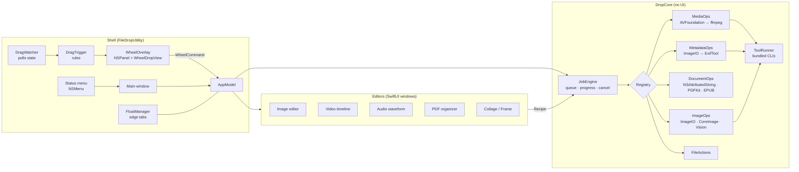

# Feature parity plan: File Drop Utility ↔ Tangerine 2.0.2

How File Drop Utility reaches the same capabilities as Tangerine, written from scratch.

## Where the feature list comes from

The "[FILL: Tangerine feature list]" input was filled from Tangerine's app bundle (`/Applications/Tangerine.app`, version 2.0.2). Sources:
- `Info.plist`
- resource and bundled-tool names, and their licence files
- the user-visible text and type names in the executable (`strings`, `otool -ov`)

No code, assets, icons, sounds or text were copied. Everything below is reimplemented with Apple frameworks or openly licensed tools.

Limits of this method: strings show *what* exists, not every option or edge case. Where an option isn't visible, the plan picks a sensible default and marks it **(inferred)**. Before calling a phase done, check it by hand against Tangerine.

## 1. Feature inventory and gap analysis

Legend: ✅ have · 🟡 partial · ❌ missing · ⛔ excluded, needs your decision (section 6).

### 1.1 Shell, triggers and app chrome

| Tangerine feature | Evidence | Ours |
|---|---|---|
| Menu-bar agent, no Dock icon | `LSUIElement`; "Find the Tangerine icon near the clock" | ✅ |
| Native status menu: ready/working line, modifier hints, Settings, Getting Started, About, Quit | screenshot; "Tangerine is ready", "Tangerine is working" | ✅ |
| Three drag wheels: Convert, Tools, Actions | "Conversion wheel"; `ConversionFanMode` | ✅ |
| **Configurable** modifier combination per wheel | `WheelModifierSettings`, `conversionWheelDragModifierMask`; "Tap the chosen modifier combination while dragging files." | ✅ (Phase 0) |
| Drag monitor polls button, modifiers, Escape and pasteboard | `DragGestureMonitor` fields | ✅ |
| Wheel highlight sound and haptics, with a setting to turn them off | `FanHighlightSoundPlayer`; "Sound and haptic feedback" | ✅ (Phase 0) |
| Wheel themes **(inferred: light/dark/tinted)** | `ConversionFanTheme`, `conversionFanThemeDidChange` | ✅ Dark, Light, Accent Tint |
| Batch drops of any size | "Batch drops of any size" | ✅ |
| **Float:** a glass tab docked to a screen edge holding a stack of files, with a paper-clip visual | `FloatingTab*` (Edge, Placement, StackPreview, PaperClip), "Create a New Float", "Add Files to an Existing Float", "Remove from Float", "Close Float without deleting files"; "Drag to carry all files"; "Double-click to open" | ✅ |
| Home-folder or chosen-folder access, so results save beside originals | "Allow Home Folder Access", "Choose a folder where Tangerine may save results…", "No folders allowed yet." | ❌ (we're unsandboxed today, see 2.6) |
| Launch at login (Login Items) | "Allow Tangerine in macOS Login Items…", "Open Login Items" | ✅ |
| Choice of terminal app (Terminal, iTerm2, …) | `TerminalApplicationSettings`, `com.googlecode.iterm2` | ✅ (Phase 0) |
| Onboarding | "Welcome to Tangerine", "Step 1. Drag files." | ✅ |
| Update notice | "Update available" | ✅ (needs a feed URL at build time; off by default) |
| Results saved next to originals | "Results are saved next to the originals." | ✅ |
| Operation progress and failures | "Operation in progress", "Operation failures" | ✅ toast + history |

### 1.2 Convert wheel: formats

Bundled tools: `ffmpeg` with LAME (LGPL), `cwebp` (BSD), ExifTool (Artistic/GPL), cupertino-files (MIT), plus PowerPoint, spreadsheet and Pages writers.

Formats found in the executable: `png jpg heic avif tiff bmp webp gif svg ai pdf mp4 mov m4v webm mkv avi mp3 wav m4a aac flac aiff ogg opus wma docx pages rtf rtfd txt md html epub textClipping key ppt pptx xls xlsx numbers csv tsv ods srt vtt zip`.

| Group | Inputs → outputs (Tangerine) | Ours |
|---|---|---|
| Images | png, jpg, heic, avif, tiff, bmp, webp, gif, svg/ai (vector artwork) → png, jpg, heic, avif, tiff, bmp, **webp**, **gif**, pdf | ✅ |
| Video | mp4, mov, m4v, webm, mkv, avi → mp4, mov, webm, gif **(inferred)**, audio-only | ✅ |
| Audio | mp3, wav, m4a, aac, flac, aiff, ogg, opus, wma → mp3, wav, m4a, aac, flac, aiff, ogg, opus; bit depth setting ("Choose an output bit depth") | ✅ |
| Text documents | docx, pages, rtf, rtfd, txt, md, html, text clippings ↔ docx, pages ("Creates a native Pages document"), rtf, txt, md, html, pdf | ✅ |
| EPUB | epub ↔ pdf, docx and others; reflowable or fixed-layout ("fixed layout book of page images") | ✅ |
| PDF out | pdf → images, text, docx ("This PDF has no selectable text…") | ✅ (plus OCR) |
| Presentations | key, ppt, pptx → pdf, images ("Bundled PowerPoint converter") | 🟡 PDF only: Keynote scripting, else Quick Look first slide |
| Spreadsheets | numbers, xls, xlsx, ods, csv, tsv → pdf, csv ("Bundled spreadsheet converter") | 🟡 PDF (Numbers scripting, else Quick Look); csv/tsv fully |
| Subtitles | srt ↔ vtt (`SubtitleConverter`, "No valid subtitle cues") | ✅ |
| Archives | zip → extracted folder ("Extracting archive") | ✅ |
| Per-format settings | "Conversion defaults are configured on the output format you choose"; Preserve metadata; Keep original dimensions; Maximum video height | 🟡 images done (quality, metadata); video and audio options come with phases 2–3 |

### 1.3 Tools wheel

| Area | Tool (Tangerine evidence) | Ours |
|---|---|---|
| Image | **Compress** with presets, modes and a target size ("Target file size", "Compression preset", "Smaller files with less quality loss.") | ✅ |
| Image | **Metadata:** view, edit and remove fields, via ExifTool (`MetadataField`, "No readable metadata found.", "Metadata Removed") | ✅ |
| Image | **Annotate:** arrows, freehand, highlighter, text boxes, numbered callouts, magnifier bubble, image stickers, colours and fonts, undo (`AnnotationMarks`, "Click to add numbered callouts", "click the detail to place a magnifier bubble", "Choose an image to place on the canvas") | ✅ (move-after-placing not yet) |
| Image | **Redact:** solid or blur ("Blur softens details. Use Solid for sensitive information.") | ✅ |
| Image | **Crop:** pixel size, and apply the same crop to every image ("Use this crop… for every image") | ✅ |
| Image | **Adjust** (`ImageAdjustmentEditor`) | ✅ |
| Image | **Background:** remove, add colour or image, change ("Add BG", "Change image background", "Save with Background") | ✅ |
| Image | **Frame or beautify:** background presets, radial gradients, canvas ratio, padding (`FrameImageEditor`, `FrameCanvasRatio`) | ✅ |
| Image | **Collage:** grid, spacing and background, fill or fit ("Creating collage", "Fill cells (crop edges)", "Fit whole images") | ✅ |
| Image | **Read QR codes** ("Reading QR codes", `QRCodeResultsPanel`) | ✅ |
| Video | **Trim** (`VideoTrimEditor`) · **Split** into clips or join remaining (`VideoSplitEditor`) · **Join** ("Select at least two videos to join") | ✅ |
| Video | **Speed** 0.25× and up (`VideoSpeedEditor`) · **Snapshots** of frames (`VideoSnapshotEditor`, "Saving snapshots") | ✅ |
| Video | **Crop** ("Keep the crop inside the video frame") · **Redact** over time ranges (`VideoRedactionTimeline`, "Show for Entire Video") | ✅ |
| Video | **Compress** with strength or target size ("The target leaves too little space for video.") | ✅ |
| Audio | **Trim** with waveform, auto-trim silent ends, silence threshold (`AudioTrimEditor`, "Detecting silence") | ✅ |
| Audio | **Bleep** ranges or the whole file (`AudioBleepTimeline`, "Save Bleeped Copy") | ✅ |
| Audio | **Normalize volume** · **Channels:** mono or stereo with L/R balance (`AudioChannelsEditor`, "Left volume") | ✅ |
| Audio | **Visualizer:** waveform video over a still image, with styles (`AudioVisualizerEditor`, "Create Visualization") | ✅ |
| PDF | **Organize:** reorder, rotate and delete pages (`PDFOrganizerEditor`, "Save Organized PDF") · **Merge** · **Compress** ("macOS PDF compression filter") · equal page widths | ✅ |

### 1.4 Actions wheel

| Action | Ours |
|---|---|
| AirDrop ("Share files and folders with AirDrop") | ✅ |
| Float | 🟡 (see 1.1) |
| Copy files and folders | ✅ |
| Copy file and folder paths | ✅ |
| Move to a chosen folder | ✅ |
| Open terminal in folder | 🟡 Terminal only |
| Share menu for the selection ("No shared actions for selected files") | 🟡 in the panel, not on the wheel |

**Count:** 53 rows (some rows group related tools): 14 ✅ · 17 🟡 · 22 ❌. Two more areas are ⛔ and listed in section 6.

## 2. Architecture



Principles:
- **Native first, bundled tool as fallback.** Each op tries Apple frameworks first (AVFoundation, ImageIO, PDFKit, `NSAttributedString`, Vision). A bundled CLI is used only where macOS can't do the job: WebP encoding, Ogg/Opus/FLAC/WMA/WebM/MKV, MP3 encoding, rich metadata editing.
- **Every tool is a recipe.** As `EditRecipe` does today, each editor produces a `Codable` recipe and DropCore renders it. That keeps the UI thin and makes everything testable without a window.
- **One job engine.** Jobs report progress, can be cancelled and run concurrently, two at a time for media. Results land in history and the toast. Long media jobs show progress in the status-menu line ("File Drop Utility is working · 42%").

### 2.1 Job engine

```swift
public protocol Job: Sendable {
  var title: String { get }
  func run(_ ctx: JobContext) async throws -> [URL]   // output URLs
}

public struct JobContext: Sendable {
  public let progress: @Sendable (Double) -> Void
  public let outputs: OutputNamer          // existing collision-safe naming
  public let checkCancelled: @Sendable () throws -> Void
}

public actor JobEngine {
  private let mediaLimit = AsyncSemaphore(2)
  public func submit(_ job: some Job) -> JobHandle { … }  // handle: progress stream, cancel()
}
```
`Processor.run` becomes a set of `Job` types. The existing `FileOperation` cases map 1:1, so no behaviour changes.

### 2.2 Bundled tool runner

```swift
public enum BundledTool: String { case ffmpeg, ffprobe, cwebp, exiftool }

public struct ToolRunner: Sendable {
  public static func run(_ tool: BundledTool, _ args: [String],
                         progress: ((Double) -> Void)? = nil) async throws -> Data {
    let url = Bundle.main.url(forAuxiliaryExecutable: tool.rawValue)!   // Contents/Helpers
    let p = Process(); p.executableURL = url; p.arguments = args
    // ffmpeg: parse "-progress pipe:2 out_time_ms=" for progress; others: exit status only.
    …
  }
}
```
- Binaries go in `Contents/Helpers`, are signed with the app and are listed in `SETUP.md` with their licences.
- ffmpeg is built **LGPL-only** (no `--enable-gpl`) and linked dynamically, so the app stays MIT-compatible.
- ExifTool is Perl and runs on the system `/usr/bin/perl`, which macOS still ships. Its Artistic licence permits bundling.
- **This needs your OK before anything is downloaded** (section 6).

### 2.3 Media ops

AVFoundation covers mp4, mov and m4v, the AAC, ALAC, WAV and AIFF audio formats, trim, speed, crop, compositing and snapshots, with hardware encoding. ffmpeg covers webm, mkv, avi, ogg, opus, flac, wma, mp3 encoding and GIF palettes.

```swift
public struct VideoRecipe: Codable, Sendable {
  public var trim: ClosedRange<Double>?
  public var splits: [Double] = []            // split points (s), ≥ 0.05 apart
  public var speed: Double = 1                // 0.25…4
  public var crop: NormRect?
  public var redactions: [TimedRect] = []     // rect + time range, solid | blur
  public var maxHeight: Int?
  public var target: CompressionTarget?       // .strength(.medium) | .bytes(Int64)
}
```
- **Target-size compression:** bitrate = (target × 8 − audio × duration − container overhead) ÷ duration, then a two-pass encode. Tangerine's error messages ("too small for this duration", "too little space for video") map to the same checks.
- **Audio:** an `AVAudioFile` read feeds a peak-per-pixel waveform cache. Normalize uses an EBU R128 loudness pass, then gain. Silence detection is a threshold in dB with a minimum length. Bleep mixes a 1kHz sine over the chosen ranges. Channels: downmix to mono, or set stereo with L/R gains.
- **Visualizer:** render waveform bars over a chosen image with `AVAssetWriter` + Core Image, in styles bars, line and circle **(inferred)**.

### 2.4 Document ops

| Path | Implementation |
|---|---|
| docx, rtf, rtfd, html, txt, odt ↔ each other, and → pdf | `NSAttributedString(url:options:documentAttributes:)` reads docx, rtf, html, odt and doc natively and writes docx, rtf, html and odt. PDF via `NSPrintOperation` to a PDF file, off screen. |
| md → html, docx, pdf | swift-markdown (Apple, Apache-2.0) → HTML → `NSAttributedString`. |
| pdf → txt, docx, images | PDFKit `page.attributedString` and `thumbnail(of:for:)` at full DPI. Scanned pages: Vision OCR. This **goes beyond** Tangerine, which says "Scanned pages need OCR". |
| epub → pdf, docx | Unzip (Apple Archive / `FileManager` + zip reader) → spine XHTML → `NSAttributedString` → output, with the safety limits Tangerine enforces (size, nesting, path escape). |
| any text → epub | Generate the EPUB 3 package (mimetype stored first, OPF, nav, XHTML), reflowable. Fixed-layout uses page images. |
| pages ↔ | **Read:** extract `preview.pdf` / `QuickLook/Preview.pdf` from the package (works for most files). **Write:** script Pages through `NSAppleScript` when Pages is installed. Tangerine has its own writer; a from-scratch writer for the IWA format is a large job (section 6). |
| key, ppt, pptx, numbers, xls, xlsx, ods → pdf | Pages, Keynote or Numbers scripting when installed. Otherwise `QLThumbnailGenerator` at full size per page is a lower-fidelity fallback. csv and tsv tables render natively. |
| srt ↔ vtt | Small parser and writer in DropCore. |
| zip → folder | `/usr/bin/ditto -x -k` (ships with macOS), with path-escape checks. |
| text clipping → txt or rtf | Read the clipping's resource data (`com.apple.finder.textclipping`). |

### 2.5 Image additions

- **WebP out** via `cwebp`, with ImageIO kept for reading. **GIF** via ImageIO, which writes animated GIF natively. **SVG/AI in:** `NSImage(contentsOf:)` renders SVG, and PDF-compatible AI files render through PDFKit.
- **Target-size compression:** binary search over quality (and scale, as a last resort) until the output is at or under the target.
- **Metadata editor:** ImageIO reads and writes the common EXIF, IPTC and GPS fields. Other fields go through ExifTool's JSON (`-j`, `-tagsFromFile`).
- **Annotate:** extend `EditRecipe.strokes` into `marks: [Mark]`, covering arrow, freehand, highlight, text, numbered callout, magnifier (circle source → enlarged bubble) and image sticker.
- **Redact:** add `.blur` to `RedactStyle` (`CIGaussianBlur`, clamped).
- **Batch crop:** normalised `NormRect` applied to every selected image.
- **Background:** after Vision's foreground mask, composite over a colour or an image.
- **Frame and collage:** pure Core Graphics renderers, `FrameRecipe` and `CollageRecipe`, with grid presets, gap, corner radius, background and fill or fit.
- **QR:** `VNDetectBarcodesRequest` with symbology `.qr`. The results panel lists each payload with Copy, plus Open for URLs.

### 2.6 Shell additions

- **Configurable modifiers:** `WheelModifierSettings` stores an `NSEvent.ModifierFlags` combination per wheel. `WheelKind.forModifiers` becomes a lookup that requires an exact match, with a recorder control in Settings. The onboarding key caps read from it.
- **Float v2:**
  - Edge-docked glass tabs (`FloatManager`), placed on the left or right edge, snap on release.
  - Each tab holds a stack of files; hovering expands it.
  - Drag out the whole stack or a single file. Double-click opens. "Add to existing Float" is a wheel sub-choice.
  - Closing never deletes files.
- **Folder access:** today the app is unsandboxed, which works. To ship on the App Store later, add security-scoped bookmarks for a home or chosen folder; the "Allow Home Folder Access" onboarding page is ready to slot in.
- **Terminal app picker:** list installed terminals (Terminal, iTerm2, Warp, Ghostty) by bundle ID; open with `NSWorkspace.open(_:withApplicationAt:)`.
- **Sound and haptics toggle; wheel theme** (Dark, Light, Accent tint).
- **Update check:** a GitHub Releases JSON check, only with your OK (it's a network call).

## 3. Phases

**Status:**
- **Phase 0:** done (2026-10-18):
  - `JobEngine`, `ToolRunner` and the helpers built and bundled
  - per-wheel modifier combinations (Settings pickers, exact match, swap on conflict)
  - sound and haptics toggle
  - terminal app picker
  - per-format settings model (`AppSettings.formatSettings`, `quality(for:)`)
  - job progress and Stop in the status menu
- **Phase 1:** done (2026-10-18):
  - WebP output (cwebp) and GIF output, keeping every frame of animations
  - SVG input
  - per-format defaults UI (own quality, preserve metadata)
  - target-size compression
  - metadata editor (ExifTool)
  - annotate marks: arrow, rectangle, ellipse, highlight, text, callout, magnifier, sticker
  - blur redaction
  - batch crop
  - background: colour or image
  - Frame, Collage, QR
  - 23 new tests
- **Phase 2:** done (2026-10-18):
  - video convert (MP4, MOV, M4V, MKV, AVI, GIF, MP3/M4A audio)
  - compress by strength or to a target size
  - trim, split (separate clips or joined kept clips), join, speed, frames, crop, timed redaction
  - video editor with a thumbnail timeline
  - Join window
  - 18 new tests on generated clips
- **Phase 3:** done (2026-10-18):
  - audio convert to MP3, M4A, AAC, WAV, AIFF, FLAC, OGG, Opus, from those plus WMA and CAF (and video soundtracks)
  - bit depth and bitrate per format
  - audio editor: waveform trim, silent-end trim with threshold, bleep ranges or whole file, EBU R128 normalize, mono/stereo with L/R balance
  - Visualizer: wave, bars or spectrum over a colour or image, three aspect ratios
  - all ffmpeg (silencedetect, loudnorm, pan, sine + amix, showwaves/showfreqs/showspectrum), rather than AVAudioFile as planned in 2.3, so every input format works the same way
  - 19 new tests on generated tones
- **Phase 4:** done (2026-10-18):
  - text family: DOCX, DOC, ODT, RTF, RTFD, TXT, Markdown, HTML, text clippings, CSV/TSV → PDF, DOCX, RTF, TXT, Markdown, HTML, EPUB, Pages
  - EPUB in and out, reflowable or fixed layout (page images from PDFs)
  - PDF → PNG/JPEG pages, text, DOCX and the rest, with Vision OCR for scanned pages
  - PDF organizer: reorder, rotate, delete, equal widths
  - SRT ↔ VTT, zip extraction with safety checks
  - Pages/Keynote/Numbers and Office files via AppleScript when the app is installed, else saved preview or Quick Look
  - Markdown uses a built-in parser rather than swift-markdown, to avoid a new dependency
  - 21 new tests
- **Phase 5:** done (2026-10-19):
  - Float v2: edge-docked glass tabs holding stacks, hover to open, drag all or one, snap to an edge, saved across launches, "Add to Float" on the Actions wheel
  - wheel themes: Dark, Light, Accent Tint
  - update check against a GitHub-style releases feed, opt-in, HTTPS only, feed set at build time
  - onboarding page for every file kind; wheel blurbs updated
  - 9 new tests
- **Open from Phase 2:**
  - WebM output: added after Phase 2 with libvpx 1.17.0 (VP9) and ffmpeg's Opus encoder.
  - Timeline handles for redaction ranges are buttons ("Set Start/End"), not draggable edges.
- **Open from Phase 1:**
  - WebP output is still-only: animated GIF → WebP takes the first frame, because `img2webp` isn't bundled.
  - Shapes and text can't be moved after placing; undo and redraw instead.

Each phase ends with tests, lint, the snapshot sheets, a hand check against Tangerine, and a commit.

| Phase | Scope | Size | Depends on |
|---|---|---|---|
| **0. Foundations** | JobEngine + progress/cancel, ToolRunner, per-format settings model, wheel modifier settings, sound toggle, terminal picker | M | – |
| **1. Images complete** | WebP/GIF out, SVG in, target-size compress, metadata editor, annotate marks, blur redact, batch crop, add/change BG, Frame, Collage, QR | L | 0, cwebp, ExifTool |
| **2. Video** | convert, compress (strength/target), trim, split/join, speed, snapshots, crop, timed redaction, GIF | L | 0, ffmpeg |
| **3. Audio** | convert, trim + silence, bleep, normalize, channels, visualizer, bit depth | M | 0, ffmpeg + LAME |
| **4. Documents** | PDF organizer, PDF → images/text/docx, rich-text family, Markdown, EPUB in/out, subtitles, zip, clippings, Pages/Keynote/Numbers via scripting | L | 0 |
| **5. Shell polish** | Float v2, wheel themes, update check, onboarding for new tools | M | 0 |

The wheel segments grow with each phase. `WheelKind.items(for:)` already enables segments per file kind, so a video drop shows video tools and an audio drop shows audio tools, as Tangerine's `validActions` does.

## 4. Testing

- **DropCore unit tests per op**, using generated fixtures: a 2s test-pattern video made with AVAssetWriter, a sine-wave WAV, an RTF/DOCX pair, a 3-page PDF and an EPUB fixture.
- **Recipes** round-trip through `Codable`.
- **Media checks:** duration, track count and dimensions (AVAsset); waveform peaks for bleep and normalize.
- **Snapshot sheets** for every new editor, in five appearances.
- A **hand-check list** per phase, run side by side with Tangerine.

## 5. Performance targets

"Works as well as Tangerine":
- Wheel opens within 1 frame of the trigger. Hover feedback within 16ms.
- Image conversion: at or below 300ms for a 12 MP HEIC → JPEG on Apple silicon.
- Video uses hardware encoders (VideoToolbox through AVFoundation, `h264_videotoolbox`/`hevc_videotoolbox` in ffmpeg).
- Media work runs off the main actor. The UI never blocks; progress updates at least every 250ms.
- Measured with `swift test` benchmarks and Instruments before each phase is marked done.

## 6. Decisions only you can make

1. **Licensing and purchases** (⛔): Tangerine's free-use counter, Unlock, restore purchases and its RevenueCat backend. These need your own App Store or payment account, so they aren't built. Say if you want an unlock flow, and with which provider.
2. **Support tickets** (⛔): needs a backend or email service you own.
3. **Downloading bundled tools:** ffmpeg (LGPL build) + LAME, libwebp's `cwebp`, ExifTool. I'll download only from the official sites (ffmpeg.org, developers.google.com/speed/webp, exiftool.org) after your OK, and record licences and checksums.
4. **Pages writing without Pages installed:** use scripting (needs Pages), or build an IWA writer (large; weeks of work).
5. **Distribution:** stay unsandboxed with a Developer ID (simplest), or prepare for the Mac App Store (sandbox + security-scoped folder access).

## 7. Filee gaps closed without new engines

Filee (MIT, C#) converts 244 formats. These are the ones macOS or the already-bundled tools handle, written from scratch in Swift. Formats that need LibreOffice, Pandoc, calibre, Ghostscript or an HWP reader stay out.

| Step | Added | How |
|---|---|---|
| 1. Images | Inputs: camera RAW (CR2, CR3, NEF, ARW, DNG, RAF, ORF and other ImageIO RAWs), PSD, ICNS, ICO, JPEG 2000, OpenEXR, TGA, PPM/PGM/PBM, Radiance HDR. Outputs: ICO (16–256 px), ICNS (16–1024 px), JPEG 2000, TGA, OpenEXR. Tools: Resize (longest side or %), Grayscale. | ImageIO; icons are squared onto a transparent canvas at each standard size |
